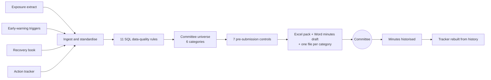
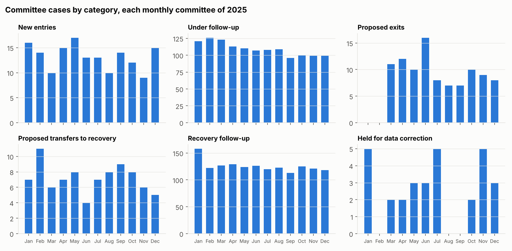
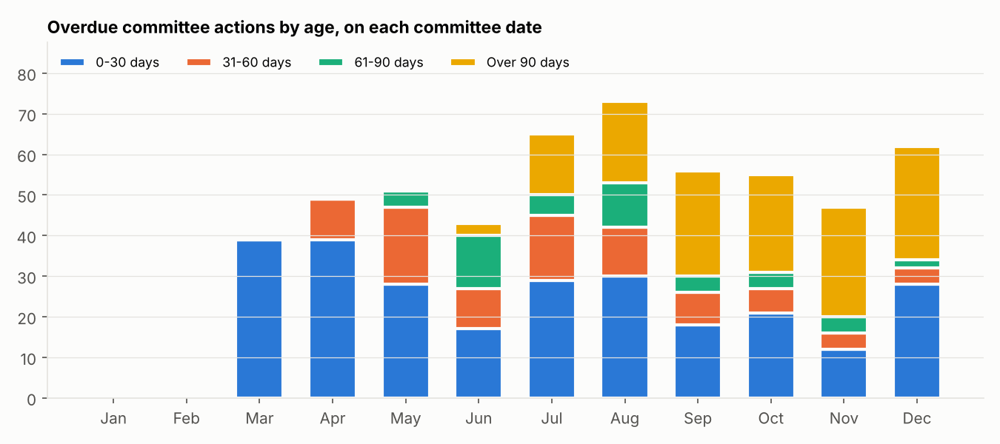
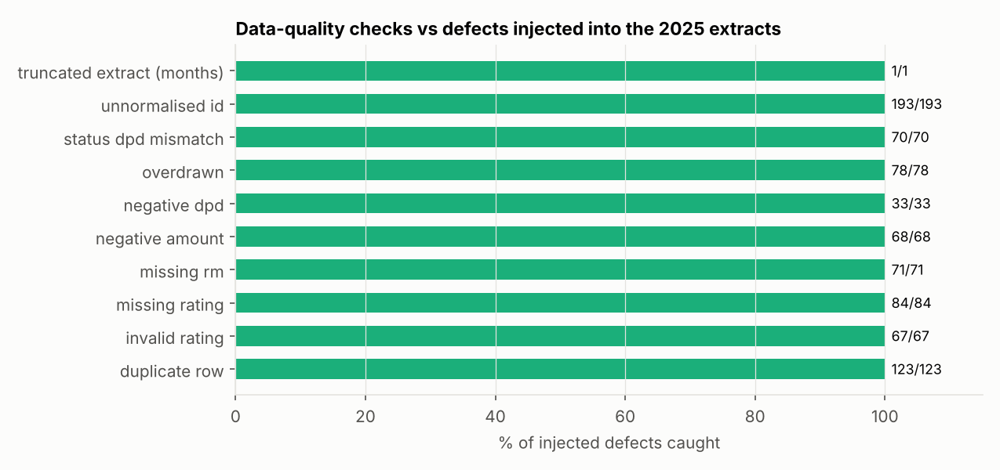

# Risk committee automation

**From four messy monthly extracts to a controlled committee pack and a clean decision history: SQL data-quality checks, case categorisation, action aging, pre-submission controls and minutes historisation.**

> **Context.** During my internship in the Counterparty Risk Surveillance department of a Moroccan bank (2026), I was asked to automate the preparation of the monthly sensitive-risk committee on the bank's Dremio data lake. I scoped and started it, then handed it over to the department at the end of the internship. This repository rebuilds the process from scratch on **synthetic** data, with **DuckDB** in place of Dremio. No bank files, layouts, names or systems are used: inputs, columns and rules are generic and invented here.

---

## The problem

Every month, a risk team prepares a committee on the corporate counterparties showing signs of stress. The work involves:
- collecting extracts that never arrive in the same format;
- joining them by hand;
- sorting each name into the right section;
- checking totals by eye;
- chasing last month's actions;
- after the meeting, retyping the decisions into a tracker with one column per committee date.

It is slow, error-prone and leaves no audit trail.

## What it does



- **Robust ingestion.** Header spellings are mapped through `config.yaml`. Amounts parse whether they arrive as `1234.56` or `1 234,56`, and IDs are trimmed and upper-cased. A new, unknown header stops the run with a clear message instead of loading wrong columns.
- **Data quality in SQL.** Eleven rules in [`sql/checks/exposures.sql`](sql/checks/exposures.sql):
  - **Blocking** issues hold the case back for correction.
  - **Warnings** go to committee with a flag.
  - **Exact duplicates and messy IDs** are fixed automatically and logged.
- **One category per name.** A single SQL query ([`sql/views/universe.sql`](sql/views/universe.sql)) sorts every name into one category: new entries, follow-up, proposed exits (3 months without a trigger), proposed transfers to recovery, recovery follow-up, or held for data correction.
- **Action tracking.** Every action decided in committee carries its status, days overdue, aging bucket and an escalation list past 60 days. It closes automatically when the name leaves the watch list.
- **Controls before circulation:**
  - the extract is complete;
  - pack totals reconcile to the extract;
  - the watch-list flow bridge balances;
  - last month's minutes are historised and the tracker agrees with history;
  - every case is complete.

  If any control fails, the pack is stamped **DRAFT**.
- **Historisation.** The minutes are loaded into a `decisions` table. The wide tracker, one column per committee date, is rebuilt from it, so the two can never drift apart.

## Results: a simulated year (12 committees, 2025)

The pipeline ran every month of 2025 on the shared synthetic book, the same 3,000 corporates as [credit-early-warning-system](https://github.com/ayoubAMEKZAZ1/credit-early-warning-system). A simulated committee took the decisions.

| | Per committee (average, range) |
|---|---|
| Cases prepared | 266 (239-307) |
| New entries / proposed exits / transfers to recovery | 13 / 8 / 7 |
| Watch list after the committee | 123 names (110-139) |
| Cases held for data correction | 2.5 (0-5) |
| Overdue actions on the committee date | 45 (0-73) |

- **Every injected defect was caught: 787 row-level defects of 9 types plus the truncated extract, with no false alarm on clean rows.** This shows the rules work as specified on known problems. It is not a performance claim: on synthetic data, clean rows are clean by construction.
- **The broken month was stopped.** In September one region was missing from the extract (−8% of names). Control C2 failed and that pack went out as a DRAFT. The other 11 packs passed every control (C7, the escalation control, only ever warns). The bridge also showed the 9 watch-list names that had vanished with the missing region.
- **The tracker never drifted.** History and the tracker matched after every committee (control C5).
- **Watch-list stays:** 166 names left the watch list during the year, after a median of 4 months; 51% exited and 49% went to recovery.

<p align="center">
  
</p>
<p align="center">
  
  
</p>

**Sample outputs:**
- [`outputs/sample_pack/`](outputs/sample_pack): the December 2025 pack and minutes draft, plus the September DRAFT pack.
- [`data/sample_inputs/2025-12/`](data/sample_inputs/2025-12): the raw inputs behind the December pack.
- [`outputs/year_report.md`](outputs/year_report.md): month-by-month figures.

## Quickstart

```bash
pip install -r requirements.txt
python scripts/run_all.py                         # 12 committees end to end, about 15 s
pytest                                            # 8 tests
COMMITTEE_DB_BACKEND=sqlite python scripts/run_all.py   # same run on SQLite (standard library)
```

GitHub Actions runs the tests on both DuckDB and SQLite ([`.github/workflows/tests.yml`](.github/workflows/tests.yml)).

## Repository layout

```
config.yaml              header synonyms, mandatory fields, thresholds, categories, aging buckets
sql/checks/              data-quality rules
sql/views/               clean extract, decision history, committee universe, action aging
src/committee/
  db.py                  DuckDB / SQLite layer (portable SQL, one engine-specific date function)
  ingest.py              read, map, parse, load staging; transpose the wide tracker
  pipeline.py            quality, universe, flow bridge, actions, controls, historisation
  pack.py                Excel pack, Word minutes draft, one CSV per category
  synth.py               synthetic monthly inputs with injected defects (testing only)
  simulate.py            simulated committee decisions and action completion (testing only)
  run.py                 bootstrap + twelve monthly cycles
  report.py              year KPIs, defect detection, figures
docs/PROCESS.md          the process before and after, controls, Dremio -> DuckDB
docs/DATA_CONTRACT.md    input files and data-quality rules
```

## Limitations

- **Simulated inputs and decisions.** The synthetic inputs and the simulated committee show that the process works end to end, not how a real committee behaves.
- **No time-saving claims.** Nothing was measured on the real process, so the repository claims no time saved.
- **Engine coverage.** Development ran on SQLite, because DuckDB could not be installed in the build environment; the CI matrix covers DuckDB.

## Author

**Ayoub Amekzaz** · B.Sc. (Hons) Data Science, Cyprus International University · ayoub1am@icloud.com

Copyright © 2026 Cyprus International University. Code under the MIT license (see `LICENSE`).
