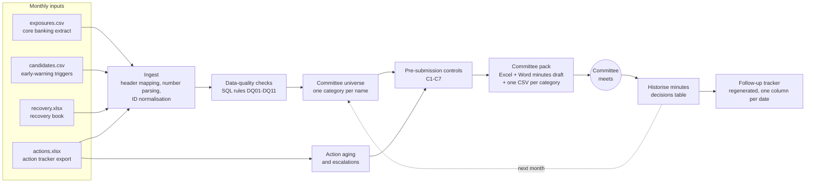

# The monthly committee process, before and after

The **sensitive risk committee** reviews, every month, the corporate and real estate counterparties that
show signs of stress:
- new names hit by early-warning triggers;
- names already on the watch list;
- names that have recovered and can leave it;
- names that have defaulted and go to the recovery team;
- files already in recovery.

## What preparing it involves by hand

Without automation, preparing the committee typically means:
1. Collecting the month's extracts (exposures, early-warning triggers, recovery book, action tracker), each in its own format.
2. Joining them in spreadsheets, name by name.
3. Deciding which section each name belongs to, and splitting the file into one file per section.
4. Checking, by eye, that amounts look right and nothing is missing.
5. Chasing the actions decided at earlier committees.
6. After the meeting, typing the decisions into a tracker that has one column per committee date.

Each step is repetitive and error-prone, and none leaves an audit trail.

## What this repository automates

| Step | What it does | Where |
|---|---|---|
| Ingest | Maps any accepted header spelling to a standard name, parses `1234.56` and `1 234,56`, and trims / upper-cases IDs. Loads staging tables and keeps every month's triggers and exposures. | `ingest.py`, `config.yaml` |
| Data quality | Eleven SQL rules. Blocking issues hold the case back for correction, warnings go to committee with a flag, and info items are fixed automatically and logged. | `sql/checks/exposures.sql`, `pipeline.run_quality` |
| Universe | One SQL query assigns each name exactly one category. | `sql/views/universe.sql` |
| Actions | Status, days overdue, aging bucket and escalation list. Actions on names that have left the watch list close with the case. | `sql/views/actions.sql` |
| Controls | Seven checks that must pass before the pack is circulated. If any fails, the pack is marked DRAFT. | `pipeline.controls` |
| Pack | Excel workbook (summary with controls and flow bridge, one sheet per category, actions, escalations, data quality), Word minutes draft, and one CSV per category. | `pack.py` |
| Historisation | After the meeting, the minutes are loaded into the `decisions` table and the wide tracker is rebuilt from it, so the tracker can no longer drift from history. | `pipeline.historise` |

The universe query assigns categories in this order of priority:
1. Held for data correction (the case has a blocking data issue)
2. Recovery follow-up
3. Proposed transfers to recovery
4. Proposed exits (on watch, no trigger for 3 months)
5. Under follow-up
6. New entries

A name reviewed with "No action" in the last two committees is not re-proposed.

## Controls

| Control | Fails when |
|---|---|
| C1 Held cases listed | Never fails; reports how many cases wait for data correction |
| C2 Extract complete | The number of names moves more than 5% from the median of the last 3 months |
| C3 Totals reconcile | The pack's on-balance total differs from the cleaned extract for the same names |
| C4 Flow bridge balances | Watch list after the last committee, minus exits, transfers and names that left, plus new entries, does not equal the proposed list |
| C5 History in sync | Last month's minutes are not in history, or the tracker disagrees with history |
| C6 Cases complete | A case lacks an RM, an exposure or a category |
| C7 Escalations | WARN (not FAIL) when actions are more than 60 days overdue |

## From Dremio to DuckDB

The process was designed for a bank data lake queried through Dremio. Here DuckDB plays that role: a
SQL engine over local files with persistent tables. The SQL is written so it also runs on SQLite, which
ships with Python. `COMMITTEE_DB_BACKEND` selects the engine, and DuckDB is used whenever it is installed.
